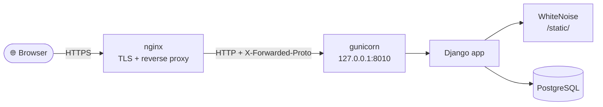
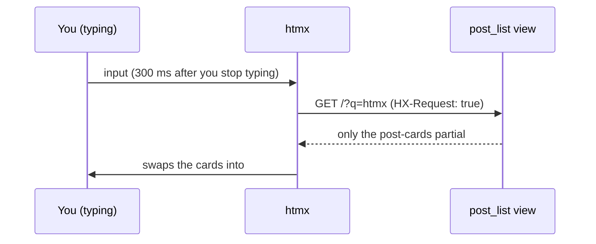

<div align="center">

# 🚀 It works on my machine. Now ship it.

**A production-ready Django CMS blog, and the talk that deploys it.**

The companion code for the PyCon ZA 2026 talk on deploying Python web apps to any Ubuntu server.


[Quick start](#-quick-start) · [How it works](#-how-it-works) · [The slide show](#-the-slide-show) · [Deploying](#-deploying-to-production) · [Troubleshooting](#-troubleshooting)

</div>

---

## ✨ What's inside

A small but real content-managed blog, built the way you'd build one for a client:

| | |
| --- | --- |
| 📝 **Posts** | Draft, published or scheduled, with categories, tags, excerpts and a rich-text editor |
| 📄 **Pages** | Standalone pages such as *About*, served at `/<slug>/` and listed in the navigation |
| 🔎 **Live search** | Search as you type, with no page reload (htmx) |
| ➕ **Load more** | Endless-style pagination with no JavaScript framework (htmx) |
| 🌗 **Dark mode** | A toggle remembered per browser, with no flash on load (Alpine.js) |
| 🛠️ **Admin** | The Django admin, restyled with [Unfold](https://unfoldadmin.com) |
| ✉️ **Email login** | A custom user model: people sign in with their email address, not a username |
| 📡 **RSS** | A feed of the latest posts at `/feed/` |
| 👀 **Draft previews** | Staff can view drafts and scheduled posts on the live site |
| 🔒 **Safe rich text** | Editor HTML is cleaned with `nh3` when saved and again when shown |
| ⚡ **Production-ready** | Split settings, secrets from the environment, WhiteNoise, HTTPS hardening, gunicorn |

---

## 🚀 Quick start

### Prerequisites

| Tool | Version | Used for |
| --- | --- | --- |
| Python | 3.14 | The app |
| Node.js | 20+ | Building the CSS and copying htmx/Alpine (build time only) |
| PostgreSQL | 14+ (developed on 18) | The database |

### 1 · Get the code and a virtual environment

```bash
git clone https://github.com/NaughtyBeanConsulting/PyConZA2026.git
cd PyConZA2026

python3 -m venv venv
source venv/bin/activate          # Windows: venv\Scripts\activate
pip install -r requirements.txt
```

### 2 · Build the front-end assets

```bash
npm install
npm run build      # Tailwind CSS + htmx + Alpine.js → static/dist/
```

### 3 · Create a database

```bash
createdb pyconza                  # or: psql -c "CREATE DATABASE pyconza;"
```

### 4 · Configure your environment

```bash
cp .env.example .env
```

Open `.env` and fill in at least the `DB_*` values. The defaults are set up for local development.

### 5 · Migrate, create an admin, add demo content

```bash
python manage.py migrate
python manage.py createsuperuser    # asks for an email address, not a username
python manage.py seed_demo          # optional: 7 demo posts and an About page
python manage.py runserver
```

🎉 Open **http://localhost:8000** for the blog and **http://localhost:8000/admin/** for the CMS.

### Day-to-day development

```bash
npm run dev                  # second terminal: rebuilds the CSS whenever a template changes
python manage.py test        # runs the test suite against PostgreSQL
```

> [!NOTE]
> The tests create a temporary `test_<DB_NAME>` database, so your `DB_USER` needs permission to
> create databases.

---

## 🧠 How it works

### The big picture



That's production. Locally, `runserver` stands in for nginx and gunicorn, and everything else
is the same.

### One codebase, two lives: split settings

```
app/settings/
├── base.py          shared: apps, middleware, PostgreSQL, auth, static files, Unfold
├── development.py   DEBUG on · emails print to the console · static served straight from disk
└── production.py    DEBUG off · secrets required · HTTPS hardening · hashed + compressed static
```

`DJANGO_SETTINGS_MODULE` picks the file. `manage.py` defaults to development, while `wsgi.py`
and `asgi.py` default to production. Each entry point loads `.env` first, so the value in `.env`
wins over these defaults, and a real environment variable wins over `.env`.

Production is deliberately strict. Without `DJANGO_SECRET_KEY` or `ALLOWED_HOSTS` it **refuses
to start**, rather than starting insecurely.

### Secrets live in the environment

- `.env` holds secrets and per-machine values. It is git-ignored and never committed.
- `.env.example` is committed: the same keys with safe placeholder values, as a checklist for the next machine.
- `python-dotenv` never overrides a variable that's already set, so your platform or CI can override anything.

### The apps

| App | What it does |
| --- | --- |
| `accounts` | The custom `User` model. Email is the login (`USERNAME_FIELD = "email"`), lower-cased so `Ann@x.com` and `ann@x.com` are the same person. The Unfold-styled user admin works with it. |
| `blog` | `Post`, `Category`, `Tag` and `Page` models, the public views, the RSS feed, template tags and the `seed_demo` command. |

**Publishing rules** (`blog/models.py`):

- A post is visible when it is **published** *and* its `published_at` is not in the future. That makes scheduling free: set a future date.
- Publishing a post stamps `published_at` automatically the first time.
- A page's slug can't take over an existing URL. `Page.clean()` checks it against the URL map, so a page called `admin` is rejected.

### htmx: search and "load more" from one template partial

The post list uses Django's built-in **template partials** (``).
A normal request renders the whole page. An htmx request gets just the cards:



- **Load more** is a real link (`?page=2`) that works without JavaScript. htmx upgrades it to replace itself with the next page of cards.
- Responses send `Vary: HX-Request`, so caches never mix up full pages and fragments.
- When you press Back, htmx sometimes asks for the page again (a history restore). The view returns the full page in that case.

### Alpine.js: the small interactive bits

`static/js/app.js` defines a shared `theme` store for the dark-mode toggle and a `copyLink`
component. A tiny inline script in `<head>` applies the saved theme before the first paint,
so the page never flashes the wrong colours.

### Tailwind and vendored scripts

`assets/app.css` is the Tailwind source. It lives outside `static/` on purpose:
`collectstatic` would otherwise try to resolve `@import "tailwindcss"` as a file. `npm run build`
writes everything the templates load into `static/dist/`:

```
static/dist/app.css        ← Tailwind (with the typography plugin), minified
static/dist/htmx.min.js    ← copied from node_modules
static/dist/alpine.min.js  ← copied from node_modules
```

There's no CDN at runtime: every script and stylesheet is served by the app itself.

> [!IMPORTANT]
> `static/dist/` is git-ignored. Any server that deploys from git must run `npm run build`
> (or receive the built files) **before** `collectstatic`, or every page fails with
> *"Missing staticfiles manifest entry"*.

### Static files: WhiteNoise

In production, `CompressedManifestStaticFilesStorage` does three things:

1. **Fingerprints** every file (`app.css` → `app.a58e12bb.css`), so a change always gets a new name.
2. **Pre-compresses** each file with Brotli and gzip at deploy time. The stylesheet goes from 33 KB to 5.6 KB.
3. **Caches** fingerprinted files for years (WhiteNoise sends a 10-year `max-age`), because a stale copy is impossible.

No separate static file server or CDN is needed.

### The admin (CMS)

- Unfold theme with a custom sidebar, and emerald colours to match the site.
- A WYSIWYG (Trix) editor for post and page bodies.
- New posts default their author to you. Bulk **Publish** and **Move to draft** actions are included.
- A **View on site** link previews drafts on the real page.

### URL map

| URL | What you get |
| --- | --- |
| `/` | Latest posts (search with `?q=`) |
| `/posts/<slug>/` | A single post (staff also see drafts) |
| `/category/<slug>/` | Posts in a category |
| `/tag/<slug>/` | Posts with a tag |
| `/feed/` | RSS feed |
| `/admin/` | The CMS |
| `/<slug>/` | A CMS page such as `/about/` (matched last) |

### Project layout

```
PyConZA2026/
├── app/                    project package: settings/, urls.py, wsgi.py, asgi.py
├── accounts/               custom email-login user model + admin
├── blog/                   models, views, admin, feed, template tags, seed_demo command
├── templates/              base layout, blog pages, partials, 404/500
├── assets/app.css          Tailwind source (built into static/dist/)
├── static/js/app.js        Alpine components
├── slide_show/             the PyCon ZA talk (reveal.js)
├── requirements.txt        pinned Python dependencies
├── package.json            front-end build (Tailwind, htmx, Alpine)
└── .env.example            every setting the app reads
```

---

## 🎤 The slide show

The talk *"It works on my machine. Now ship it."* lives in [`slide_show/`](slide_show/).
It's a [reveal.js](https://revealjs.com) deck that walks through deploying **this app** from a
fresh Ubuntu VM to a live HTTPS site in ten stops. It also includes a "museum" of real errors
hit along the way. reveal.js and the fonts are bundled, so it runs **without an internet
connection**.

### Start the slide show server

```bash
cd slide_show
python3 -m http.server 8000
```

Then open **http://localhost:8000**.

> [!TIP]
> Serve it rather than double-clicking `index.html`: the speaker-notes window needs the deck
> served over HTTP.

### Presenting

| Key | Action |
| --- | --- |
| `S` | Speaker view: notes with timing cues, a clock, the next slide |
| `F` | Fullscreen |
| `Esc` / `O` | Overview of every slide |
| `B` / `.` | Black out the screen |
| `Alt`+click (`Ctrl`+click on Linux) | Zoom into a screenshot |
| `→` / `Space` | Next step |

The talk runs 30 minutes, with 32 slides. See [`slide_show/README.md`](slide_show/README.md)
for the running order.

---

## 🌍 Deploying to production

The slide show covers this in detail. In short, on any Ubuntu VM:

```bash
pip install -r requirements.txt
npm ci && npm run build                       # or copy static/dist/ from CI
python manage.py collectstatic --noinput
python manage.py migrate
python manage.py check --deploy
gunicorn app.wsgi --bind 127.0.0.1:8010 --workers 3
```

Then:

- **Keep gunicorn alive** with a systemd unit: run it as a non-root user with `Restart=always`, and use `LogsDirectory=gunicorn` so its log folder always exists.
- **Put nginx in front** to handle HTTPS and proxy to `127.0.0.1:8010`. The proxy **must** send `proxy_set_header X-Forwarded-Proto $scheme;`, or Django's HTTPS redirect loops forever.
- **Keep PostgreSQL private.** The app connects over `127.0.0.1`. For a GUI such as DBeaver, connect through an SSH tunnel rather than opening port 5432.

### Environment variables

| Variable | Development | Production |
| --- | --- | --- |
| `DJANGO_SETTINGS_MODULE` | `app.settings.development` | `app.settings.production` |
| `DJANGO_SECRET_KEY` | optional (a dev key is used) | **required**, long and random |
| `DEBUG` | `True` | ignored (always off) |
| `ALLOWED_HOSTS` | `localhost,127.0.0.1` | **required**, e.g. `blog.example.com` |
| `CSRF_TRUSTED_ORIGINS` | empty | e.g. `https://blog.example.com` |
| `SITE_URL` | `http://localhost:8000` | e.g. `https://blog.example.com` |
| `DB_NAME` · `DB_USER` · `DB_PASSWORD` · `DB_HOST` · `DB_PORT` | your local Postgres | `DB_HOST=127.0.0.1` when Postgres is on the same server |
| `SECURE_SSL_REDIRECT` | — | default `True` |
| `SECURE_HSTS_SECONDS` | — | default `3600`. Raise it to `31536000` once HTTPS is solid |
| `SECURE_HSTS_PRELOAD` | — | default `False`. Opt in only if you'll submit the domain to the preload list |
| `DJANGO_LOG_LEVEL` | — | default `INFO` (logs go to stdout) |

Generate a secret key with:

```bash
python -c "from django.core.management.utils import get_random_secret_key as g; print(g())"
```

---

## 🩺 Troubleshooting

Every one of these happened while preparing the talk.

| Symptom | Likely cause | Fix |
| --- | --- | --- |
| `Missing staticfiles manifest entry for 'dist/app.css'` | `static/dist/` was never built on the server | `npm run build`, then `collectstatic`, then restart gunicorn |
| `ERR_TOO_MANY_REDIRECTS` | nginx isn't telling Django the request was HTTPS | Add `proxy_set_header X-Forwarded-Proto $scheme;` |
| gunicorn restarts endlessly: `… isn't writable` | Its log directory doesn't exist | `LogsDirectory=gunicorn` in the systemd unit |
| `no pg_hba.conf entry for host …` | The app connects using the server's network IP | `DB_HOST=127.0.0.1` |
| `Connection refused` on port 5432 | Postgres only listens on localhost (usually what you want) | Use an SSH tunnel, or open it to one IP only |
| `Set the DJANGO_SECRET_KEY environment variable` | Production settings without a `.env` | Create `.env` on the server (it isn't in git) |
| `DNS_PROBE_FINISHED_NXDOMAIN` | The domain doesn't point at the server yet | Add the DNS A record (or a hosts entry for a local domain) |
| `ERR_CERT_AUTHORITY_INVALID` | A certificate from a CA your browser doesn't trust | Use Let's Encrypt, or trust your local CA (`mkcert -install`) |

---

<div align="center">

Built for **[PyCon ZA 2026](https://za.pycon.org)** by Shaun De Ponte · NaughtyBean Consulting

</div>
